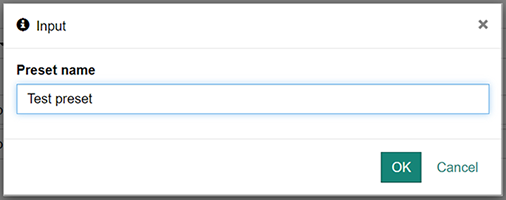
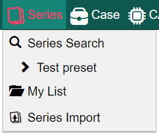

As the number of items (series, cases, and plug-in jobs) managed in CIRCUS increases, it becomes more difficult to find the items you want. Search presets and My Lists allow you to quickly find the items you are interested in.

The description in this page applies to the following three types of search:

- [Series Search](/docs/users/series-search)
- [Case Search](/docs/users/case-search) (CIRCUS DB)
- [Plug-in Job Search](/docs/users/plugin-job-search) (CIRCUS CS)

## Search Presets

A search preset is a named set of search conditions that you use frequently.

### Making a Search Preset

1. Go to one of the search pages, and perform a search as usual with the condition you want to save.

   <Tip title="Relative Date and Absolute Date">

   For date-based search conditions, you can specify a "relative" condition to perform searches relative to the current date. For example, you can make a preset to always display series that were imported 0 to 1 days before the search (i.e., today and yesterday). It's also possible to specify an absolute date condition, which always refers to the date you specify (e.g. '2020-05-01').

   </Tip>

2. Click the "Save" button, and enter a name for the preset.

   

3. The saved preset will appear in the top menu (under "Series" for series search presets, "Case" for case search presets, "CAD" for plug-in job search presets).

   

### Deleting a Search Preset

You can delete a saved search preset in the [User Preference](/docs/users/user-preference) page.

## My List

My List allows you to create a collection of items (series, cases or plug-in jobs).

Each My List can contain only one type of item. For example, you cannot create a My List that contains both cases and plug-in jobs. The number of items a list can contain is limited to 1,000.

<Tip title="Tags vs My Lists">

You can also assign tags to CIRCUS DB cases. Although conceptually similar, tags are shared by all users and are displayed prominently on the screen. Use tags to mark shared state of a case (e.g., "Reviewed", "High Priority") and use My Lists for personal collections.

</Tip>

### Creating a My List

1. Select one of the [My List] links under "Series", "Case" or "CAD".

2. Press [New] and enter a name for the new list.

You can delete or rename a list from the same screen.

### Adding or Removing Items

1. Go to any of the search pages, and click the checkbox to the left of each item.

2. Use the menu that appears at the top of the search results to select the list to which you want to add the items.
